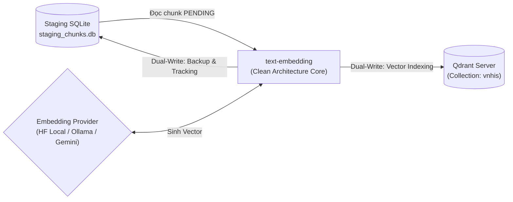

# ⚡ Text Embedding Pipeline

[](https://www.python.org/)
[](#-kiến-trúc-mã-nguồn-clean-architecture)
[](https://qdrant.tech/)
[](#-điểm-nhấn-kỹ-thuật-engineering-highlights)

**Quy trình nhúng vector (Vector Embedding Pipeline)**, chuyển đổi các phân đoạn văn bản (text chunks) thành vector đặc trưng và nạp vào cơ sở dữ liệu vector.

---

## Bối cảnh Hệ thống

Trong kiến trúc tổng thể của hệ thống RAG / GraphRAG, việc chuẩn bị dữ liệu được phân tách thành hai quy trình xử lý độc lập trước khi nạp vào các cơ sở dữ liệu chuyên dụng:

1. **Quy trình trích xuất đồ thị (`text2triple`):** Sử dụng LLM bóc tách thực thể và quan hệ theo ontology / schema định sẵn để nạp vào **Neo4j**.
2. **Quy trình nhúng vector (`text-embedding` -** repo hiện tại): Tiếp nhận dữ liệu phân đoạn văn bản từ database staging, tính toán vector biểu diễn ngữ nghĩa và lưu trữ song song vào **SQLite** (bản lưu trữ sao lưu & theo dõi trạng thái) và **Qdrant** (phục vụ tìm kiếm ngữ nghĩa thời gian thực).



---

## Kiến trúc Mã nguồn
```text
src/
├── domain/                      # Lớp Domain: Độc lập 100%, không phụ thuộc thư viện ngoài
│   ├── models.py                # Entities & Value Objects (EmbeddingVector, VectorRecord)
│   ├── exceptions.py            # Custom Domain Exceptions
│   └── ports/                   # Abstract Interfaces (Ports)
│       ├── embedding_port.py    # Interface giao tiếp với Embedding Models
│       ├── sql_database_port.py # Interface tương tác SQLite
│       └── vector_database_port.py # Interface tương tác Qdrant
├── application/                 # Lớp Application: Nghiệp vụ phối hợp
│   └── use_cases/
│       └── embed_chunks.py      # UseCase: Điều phối batching, retry, dual-write & thống kê
├── infrastructure/              # Lớp Infrastructure: Hiện thực hóa các Ports (Adapters)
│   ├── config.py                # Quản lý nạp biến môi trường (.env)
│   ├── embedding_adapters/      # Adapters cho HuggingFace (Local/API), Ollama, Google AI Studio
│   ├── sql_database_adapters/   # Adapter SQLite qua SQLAlchemy ORM
│   └── vector_database_adapters/# Adapter Qdrant client
├── bootstrap.py                 # Composition Root: Dependency Injection container
└── entrypoints/                 # Điểm chạy chương trình
    └── embed_chunks.py          # Script thực thi pipeline chính
```

---